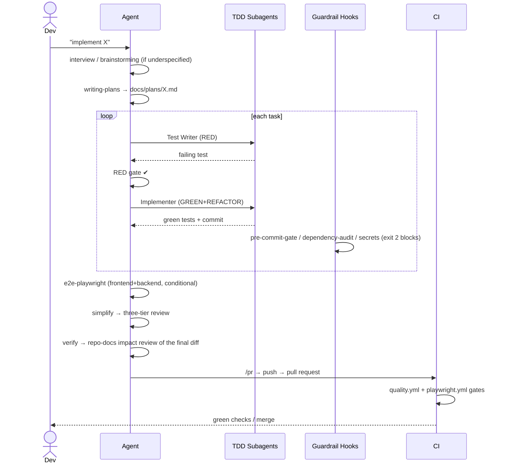
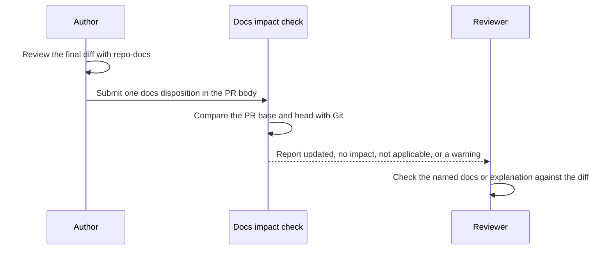
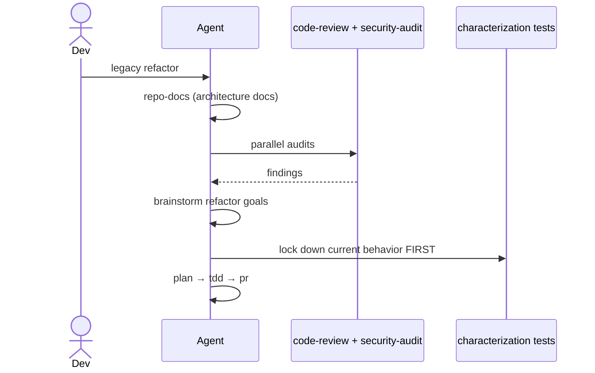
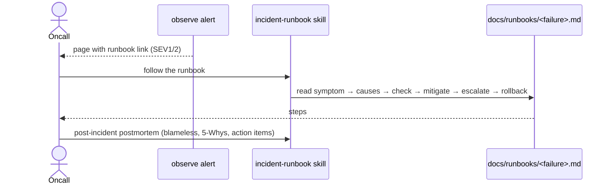
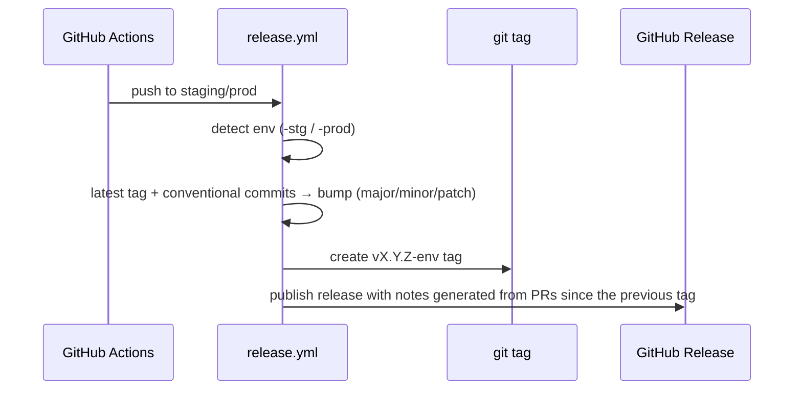
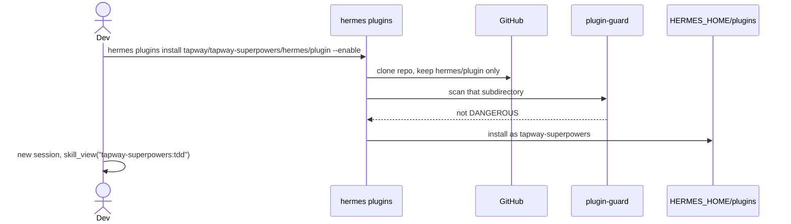

# Workflows — Tapway Superpowers

One section per significant workflow. These are the flows a developer (or agent)
goes through when using the plugin, plus the flows the plugin itself runs.

## Workflow: Solo Feature Build (Individual Mode)

**Trigger:** Developer asks the agent to implement a feature or fix a bug
**Actor:** Developer + coding agent



**Description:**
The agent runs the strict pipeline in order — interview → brainstorm → plan →
TDD → E2E → simplify → review → PR. Hooks fire at tool-use time: a commit that
fails lint/format/typecheck/coverage, or that contains a critical dependency
vulnerability, is blocked before it happens (`exit 2` on PreToolUse).

**Edge Cases / Failure Modes:**
- Task fails twice → coordinator pauses and reports the blocker instead of pushing on.
- `/review` finds Critical issues → fixed before the PR opens.
- E2E gate skips when only docs/config changed (conditional file detection).
- A commit with failing quality gates → blocked by the hook; agent fixes and re-commits.

## Workflow: Docs impact review (advisory pilot)

**Trigger:** A coding task is completed, or a Superpowers PR is opened, updated,
reopened, or has its description edited. **Actor:** Author, reviewer, and GitHub Actions.



Review behavior, interfaces, schemas, workflows, configuration, and deployment.
Change only the affected docs. For a code PR, add one plain line:

- `Docs: updated — docs/WORKFLOWS.md` (use the actual paths, comma-separated).
- `Docs: no impact — Refactored Git fixture setup; documented behavior is unchanged.`

`README.md` and Markdown under `docs/` are eligible; plans, brainstorms,
checklists, specs, and post-mortems do not count as maintained docs for this check.
A deleted doc cannot be the only evidence of an update. Docs-only PRs are not
applicable and do not need a line. CI checks the declaration and diff; it does
not attest skill invocation or the accuracy of a no-impact explanation.

The **Docs impact** job is advisory for this repository: a missing or invalid
line produces a warning, not a policy failure. An unreadable event or Git diff
fails the check rather than reporting a review it could not do. Other callers
are unchanged unless they explicitly pass `enforce_docs_impact: true` to the
reusable `workflow-gate.yml` and subscribe to PR-description edits in their
calling workflow. Requiring the job at merge is a separate GitHub ruleset step;
do not require the advisory job. To end the pilot without enforcing it, remove
the Superpowers-only advisory enablement without changing the existing contracts job.

## Workflow: Automated Ship (autoship)

**Trigger:** "implement it with autopilot" / "ship and deploy"
**Actor:** Developer + autoship coordinator

```mermaid
sequenceDiagram
  actor Dev
  participant Coord as autoship coordinator
  participant Loop as Task loop (TDD subagents)
  participant Docs as repo-docs
  participant CI

  Dev->>Coord: autoship [deploy mode]
  Coord->>Coord: plan health check
  Loop->>Loop: per task: RED→GREEN→review
  Coord->>Docs: update docs (mandatory)
  alt deploy mode
    Coord->>Coord: detect deploy method → deploy to staging
    Coord->>Coord: health-check loop (60s)
    Coord->>Coord: run integration + E2E suites
  end
  Coord->>CI: open PR with evidence
  CI-->>Dev: gate results
```

**Description:**
Autoship runs the whole plan-to-PR loop without human intervention. Deploy mode
adds: deploy to staging, health check, and integration/E2E execution before the
PR opens — never a PR with a broken deployment.

**Edge Cases / Failure Modes:**
- Deployment fails → coordinator does NOT open the PR; reports and waits.
- Health check times out → logs last 50 lines, suggests rollback, does not PR.
- E2E gate mandatory in **standard mode** too (not just deploy mode) for
  frontend/backend changes.

## Workflow: Legacy Refactor

**Trigger:** Taking over an untested codebase
**Actor:** Developer + agent



**Description:**
Legacy mode writes **characterization tests** (capture current behavior) before
any refactor — you cannot safely change code you haven't locked down.

**Edge Cases / Failure Modes:**
- Characterization RED fails because code is too coupled to unit-test →
  decouple/extract until tests pass.
- Bulk mechanical changes (renames) → use the community `code-refactor` skill,
  but only after characterization tests exist.

## Workflow: Incident Response

**Trigger:** An alert from `observe` fires (or an incident happens)
**Actor:** On-call engineer + `incident-runbook` skill



**Description:**
Every `observe` alert links to a runbook; the `incident-runbook` skill creates
and maintains those runbooks (SEV1–4) and the blameless postmortem with owned,
dated action items.

**Edge Cases / Failure Modes:**
- Alert without a runbook → `observe` now instructs the agent to create one
  before shipping the alert.
- Postmortem blames a person → skill's hard rule forbids it (name processes/gaps).
- Suggested rollback = DB downgrade → skill forbids it (expand-contract instead).

## Workflow: Release

**Trigger:** PR merges to `staging` or `prod`
**Actor:** GitHub Actions `release.yml`



**Description:**
Semantic versioning with an environment suffix (`v1.2.3-stg` / `-prod`). The
bump is derived from conventional commits since the last tag for the same env.

**Edge Cases / Failure Modes:**
- No prior tag for the env → starts from 0.0.0 so the first conventional commit
  rolls to a sane version.
- No PR merged since the previous tag → GitHub's notes carry only the compare link.

**Planned — nightly auto-update (issue #67).** The PR-based skill sync is
replaced by a nightly release: commit to `main`, bump the version in every
manifest a harness reads, tag, publish. Claude Code consumes it through its
marketplace auto-update (opt-in per user); Hermes consumes generated companion
repos (`tapway-superpowers-hermes`, `tapway-skills-hermes`) whose root is the
plugin, so `plugins.auto_apply` can update them. Design and the anti-drift
invariants: [docs/brainstorming/native-auto-update.md](brainstorming/native-auto-update.md).

## Workflow: Install the Hermes plugin

**Trigger:** A Hermes user wants Tapway skills without cloning this repo
**Actor:** Developer + `hermes` CLI



**Description:**
The subdirectory install is the supported path. Installing the repository root
is rejected: plugin-guard marks hooks and installer docs DANGEROUS. Plugin
skills are namespaced and do not create `/tdd`-style slash commands. Use
`hermes/install.sh` for the `/tapway` bundle.

The plugin ships its own copy of `hermes/skills/` so an install is
self-contained. After adding or editing a skill, refresh the mirror:

```bash
./scripts/sync-hermes-plugin-skills.sh          # hermes/skills -> hermes/plugin/skills
./scripts/sync-hermes-plugin-skills.sh --check  # exit 1 when the trees differ
```

**Edge Cases / Failure Modes:**
- Install of the repo root → blocked. Retry with the `hermes/plugin` suffix.
- Skill text drifts from `hermes/skills/` → run the sync script.
  `tests/test_hermes_plugin.py` and `--check` both fail until the mirror is
  refreshed.
- Expecting `/brainstorming` from the plugin → it will not appear. Load
  `tapway-superpowers:brainstorming`, or run `install.sh` for slash commands.


## Hook-enforced contracts (v2.6.0)

| Gate | Where | Blocks |
|---|---|---|
| Brainstorm grounding | `pre-brainstorm-ground` (Claude/Codex) + Hermes `pre_tool_call` | a write to `docs/brainstorming/*.md` whose option sections carry no `Grounding:` line |
| Plan → issue | `pre-pr-contract` on `gh pr create`, plus `workflow-gate` CI; `post-plan-issue` creates the issue | a `docs/plans/*.md` without `issue: <number>` frontmatter (accepted `docs/brainstorming/*.md` also create one; proposed drafts do not) |
| Payload shapes | `hooks/lib/hook_payload.py` | n/a — normalises Claude (`tool_input`), Hermes (`args`) and Codex (flat) so every gate reads one shape |

The gates default **on under CodeMAX** (`CODEMAX_WORKFLOW=1` or a `.codemax.yml`)
and off elsewhere. `TAPWAY_BRAINSTORM_GATE=0` and `TAPWAY_PR_GATE=0` are the
documented per-run overrides; CI is still authoritative.
