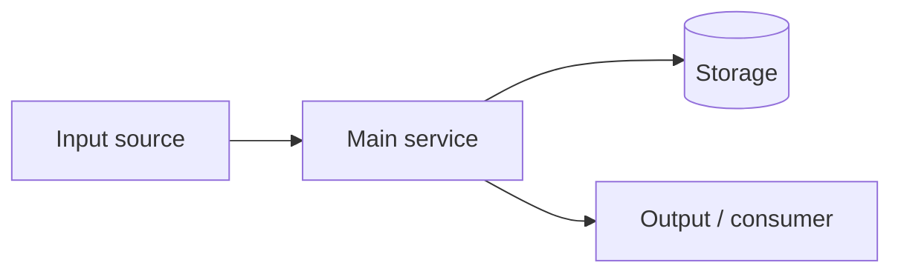

# How it works page template

Purpose: the big picture. The main pieces, what each one does, and how data moves between them. A reader should be able to sketch the system on a whiteboard afterwards. Leave exact config values and API parameters for Technical Details.

~~~markdown
# How it works

<Two or three sentences summarising the flow end to end, from input to output.>

## The big picture

## The main pieces
| Piece | What it does | Lives in |
|---|---|---|
| <component> | <one line, plain words> | `<folder/>` |

## Step by step: what happens to one <request / event / frame>
1. <Where it comes from>
2. <What happens to it first>
3. <Where decisions are made>
4. <Where the result goes>

## How it talks to other systems
<Upstream and downstream systems: what it receives, from whom, and in what form (HTTP, MQTT, Redis, database, files). Link other repos' wikis if they exist.>

## Key design decisions
- **<Decision>**: <why it was made and what the trade-off is>. Mark unknown reasons with ❓ Ask the team.

## Where to look in the code
<A short map of the folders that matter most, so readers know where to start reading.>
~~~

One diagram for the whole system, plus at most one more for the most complex flow. Name boxes after what they do, not only after class names.
